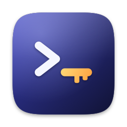

<p align="center"></p>

# sx — secrets your agents can use, not read

**sx** ("secrets exec") is a macOS menu bar app plus a command-line tool for developers who work with AI coding agents (Claude Code, Codex, Cursor, …).

Keys live in your iCloud Keychain — or in Bitwarden, 1Password, or a backend you plug in — not in `.env` files. Projects keep a `.env.sx` with references only. `sx run` gives the real values to the process you start, masks them in its output, and asks you first.

```console
$ sx import-env .env --prefix myapp --remove-original
✓ OPENAI_KEY → sx://myapp/OPENAI_KEY
✓ STRIPE_KEY → sx://myapp/STRIPE_KEY

$ sx run -- npm run dev          # you or your agent; Touch ID once per command
  ready on http://localhost:3000 with key <sx:OPENAI_KEY>

$ sx run -- printenv OPENAI_KEY  # what an agent gets if it tries to peek
sx: refused for Claude Code: `printenv` only prints the environment
```

> Status: **0.2, early.** Written by one developer, not independently audited. The Bitwarden and 1Password backends have not yet been exercised against real accounts. Read [Security model](#security-model) and [Limits](#limits) before trusting it with production keys.

## Why

Agents read files and terminal output, and what they read is sent to a model provider. A plain `.env` in the repo means keys end up in transcripts. sx keeps values out of files and out of output while the code that needs them still runs.

## Install

Download the DMG from [nvlab.co/sx](https://nvlab.co/sx/), drag **sx** to Applications, open it once. Then **Command line → Install** links `/usr/local/bin/sx` to the copy inside the app.

Requirements: macOS 14+, Apple silicon or Intel. iCloud Keychain on if you want secrets to follow you to other Macs.

## Use

### Keychain secrets (default vault)

```sh
sx put myapp/STRIPE_KEY --tag prod              # hidden prompt, or pipe the value on stdin
sx import-env .env --prefix myapp               # moves values in, writes .env.sx next to it
sx import-file ./AuthKey.p8 --name apple/asc    # any file
sx ls                                           # names only; values are never printed
sx verify myapp/STRIPE_KEY --file old.txt       # compares hashes
sx run -- npm test                              # reads .env.sx in the current directory
sx run --env-file deploy.env.sx -- make deploy
sx run --env API=sx://myapp/OPENAI_KEY -- ./script.sh
```

`.env.sx` is ordinary dotenv. `KEY=sx://name` is resolved, everything else passes through:

```dotenv
OPENAI_KEY=sx://myapp/OPENAI_KEY
CI_TOKEN=sx://@work/ci/token     # explicit vault
PORT=3000
```

### Several vaults

`~/.config/sx/config.toml` (no secrets in it) defines vaults and which directories use which:

```toml
default = "personal"            # the built-in iCloud Keychain vault

[vault.work]
backend = "bitwarden"
server  = "https://vault.example.com"   # optional; omit for bitwarden.com

[vault.client]
backend = "1password"
account = "client.1password.com"        # optional

[vault.hc]
backend = "plugin"
type    = "hashicorp"                   # runs `sx-backend-hashicorp`

[route]
"~/Developer/work/**"   = "work"
"~/Developer/client/**" = "client"
```

- **Bitwarden**: `sx login work` unlocks once (`bw` CLI) and keeps the session in the keychain; `sx run` asks before using it. Names are item names; `item#field` reads a custom field.
- **1Password**: names are `Vault/Item` or `Vault/Item/field`; `op` handles its own unlock.
- **Your own backend**: any executable, see [docs/plugins.md](docs/plugins.md).

`sx vaults` shows the configuration and which vault the current directory routes to.

### Agents and project allowlists

Under an agent, sx:

- refuses commands that only print the environment or run inline code: `env`, `printenv`, `sh -c`, `python -c`, `node -e`, …;
- never turns masking off (`--no-mask` is human-only);
- shows an approval card — who asks, which command, which project, which secrets — before releasing anything. Touch ID, then remembered for that exact command for 8 hours (configurable). Secrets tagged `prod` ask every time.

A project can pre-approve what agents may run with `.sx.toml`:

```toml
[agents]
allow   = ["npm run dev", "npm test", "wrangler deploy"]
require = true          # agents may run nothing else with secrets

[vault]
default = "work"        # optional: vault for this project's references
```

The file does nothing until a human runs `sx trust` (Touch ID). The approved digest is stored in the keychain, so any later edit — by you or an agent — un-trusts it until approved again.

### SSH agent

```sh
sx ssh import ~/.ssh/id_ed25519 --remove-original   # ed25519 and RSA, unencrypted OpenSSH format
sx ssh setup --write                                # IdentityAgent in ~/.ssh/config
ssh -T git@github.com
```

Private keys never leave Sx.app; `ssh` gets public keys and signatures. The first use of a key by a given caller shows a card with the process chain (e.g. `ssh ← git ← claude`). Passphrase-protected keys must be stored as an unencrypted copy — the keychain and Touch ID take the passphrase's role.

## Security model

- **Storage**: keychain items in the data-protection keychain, access group `<TEAM>.dev.nvlab.sx`, synchronizable through iCloud Keychain (end-to-end encrypted by Apple). Only an app signed by that team with that entitlement can read them.
- **Broker**: Sx.app listens on a Unix socket in its app-group container. Every connection's code signature is checked via its audit token; only the `sx` binary signed by the same team (`identifier dev.nvlab.sx.cli`) is served. Other processes are refused.
- **Approval**: Sx.app decides, not the CLI. Agent detection uses the caller's process ancestry, which an agent cannot rewrite (environment variables are a secondary signal).
- **Trust store**: `.sx.toml` approvals are keychain items on this Mac only — not files an agent could edit.
- **No network**: neither the app nor the CLI makes network calls. Bitwarden/1Password/plugin backends are their own tools.
- **Audit log**: `~/Library/Logs/sx-audit.jsonl` — who, which command, which names, outcome. Never values.

## Limits

- **A program that legitimately receives a secret can leak it.** If an agent edits your code to send `process.env` somewhere and then runs an allowed command, sx cannot see that. Give agents development keys with narrow scopes; tag production keys `prod`.
- **Masking covers stdout/stderr only**, not files or network traffic the program creates. Short values (< 4 bytes) are not masked.
- **macOS only.** No Linux, Windows or CI runners.
- **Not a team password manager.** Use Bitwarden or 1Password for shared secrets; sx can read from them.
- The Developer ID build is not sandboxed: the sandbox blocks code-signature checks of socket clients. An App Store build would need an XPC-based broker.

## Build from source

Requirements: Xcode 16+, [XcodeGen](https://github.com/yonaskolb/XcodeGen), an Apple Developer account signed in to Xcode.

```sh
make test       # unit tests (SwiftPM)
make install    # builds CLI + app, installs to /Applications, links ~/.local/bin/sx
make dmg        # signed installer
make release    # notarized via the Xcode account, then DMG
```

Official builds are signed by team `37A7P47GPA`. For your own build, replace the team ID in `Sources/SxCore/Constants.swift` (`teamID`) and `App/project.yml` (`DEVELOPMENT_TEAM`, `application-groups`) and change the bundle IDs. Builds from different teams cannot read each other's secrets — that is the point.

Layout:

```
Sources/SxCore   shared: protocol, dotenv, redaction, policy, vault config, SSH keys
Sources/sx       CLI
App/Sources      Sx.app: broker, keychain store, approvals, SSH agent, UI
design/          icon and DMG art, rendered from code (make icons)
```

## License

[MIT](LICENSE) © 2026 Nazar Voitovych · [nvlab.co](https://nvlab.co) · security reports: see [SECURITY.md](SECURITY.md)
